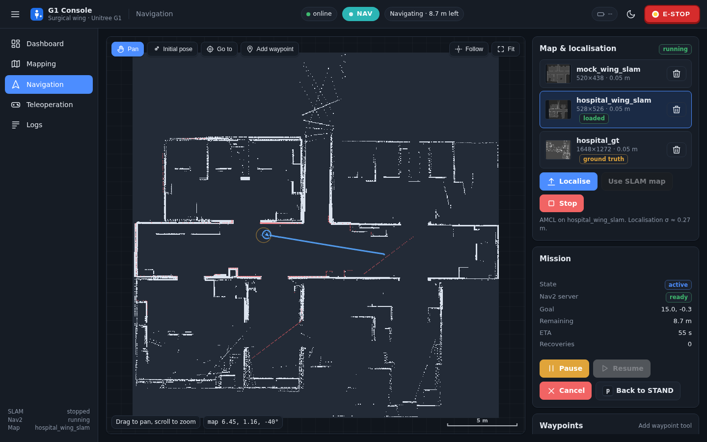

# G1 UI server: iPad app + engineering console

The web front end and the aiohttp/rclpy server behind it. The server needs `hospital-sim-ros2` for the
`g1_interfaces` messages, the maps in `g1_navigation/maps`, the mission config in `g1_mission/config` and the
`g1_teleop_manager` zones. The mock robot additionally needs `g1-mujoco-sim` and `hospital-sim-env` for its
world. All of that is in place in a `hospital-sim` checkout, whose `env.sh` sets `HG1_ROOT`, ROS 2 Humble, the
shared `.venv` and the `ros2_ws` overlay. `g1_bringup`'s `dashboard.launch.py` starts the server; it can also
be started by hand as below. Paths in this README are from the master repo root, so files in this repo appear
under `hospital-sim-ui/`.

One server (`hospital-sim-ui/server`) serves two front ends:

| URL | What | Who |
|---|---|---|
| `https://<robot>:8443/` | **iPad app** (`hospital-sim-ui/app/`, protocol v2: roles, Stop/Resume, alarms, send-to, instruments) | theatre staff, operators, technicians |
| `https://<robot>:8443/console/` | **G1 Console**, the engineering dashboard below (`hospital-sim-ui/web/`, protocol v1) | developers |
| `http://127.0.0.1:8080/` and `/console/` | the same over plain HTTP, **loopback only** (development on the robot PC; the console there signs in as technician) | developers |

Protocol: [PROTOCOL.md](PROTOCOL.md) (v1 console ops + v2 app ops). Design brief: `docs/ui/README.md`.

## iPad setup (HTTPS, one-time per robot)

The iPad only talks to the robot over HTTPS/WSS (Safari needs a secure context for Wake Lock, speech and
getUserMedia; docs/ui/02 L-4). The robot runs its own small certificate authority until the hospital CA is used.

1. On the robot PC: `hospital-sim-ui/server/tls/make_cert.sh` (no sudo; python `cryptography`). It creates
   `hospital-sim-ui/server/tls/out/{ca.crt, ca.key, server.crt, server.key}`. The server certificate covers `localhost`, the
   hostname, `<hostname>.local` and every LAN IPv4 address; re-run it when the robot's IP changes (the CA is kept, so
   iPads keep trusting it). `--names robot.local 10.0.0.5` adds names; `--new-ca` starts over.
2. Get `ca.crt` onto the iPad: **AirDrop** it or **e-mail** it as an attachment (tap it in Mail), or open
   `https://<robot-ip>:8443/tls/ca.crt` in Safari once (accept the warning that one time).
3. iPad: **Settings → General → VPN & Device Management** (older iPadOS: "Profile Downloaded" at the top of
   Settings) → install the "G1 robot local CA" profile.
4. **Settings → General → About → Certificate Trust Settings** → switch on full trust for "G1 robot local CA".
5. Open `https://<robot-ip>:8443/` in Safari → Share → **Add to Home Screen** (runs full screen). In a hospital:
   supervised iPads, MDM pushes the hospital-CA certificate and the web clip / WKWebView wrapper (02 D-1).

The server prints its URLs at start. Without certificates it serves plain HTTP only (on `--host`) and warns.

## Roles, PINs (test defaults) and control

| Role | Sign in | Falls back to Clinical | Can do |
|---|---|---|---|
| Clinical | nothing (walk-up) | never | Stop, Resume, Power off, Send to, Request instrument, Cancel, acknowledge alarms, send problem to technician, checks (nurse part) |
| Operator | PIN **123456** (role PIN) or personal PIN, e.g. R. Kumar **246810** / badge `04A1B2C3` | 10 min idle | + take control (lease), manual walking / arms, map goals, routes, missions |
| Technician | PIN **987654**, or T. Lee **135790** / badge `04D4E5F6` | 5 min idle | + mapping, stacks, audit log, incidents, alarm stats, suppress Low alarms |

The PINs live as PBKDF2 hashes in `hospital-sim-ui/server/config/auth.yaml` (**change them before any real use**:
`python hospital-sim-ui/server/auth.py set-pin operator <new>`; `two_factor: true` makes technicians use badge + PIN). The server
enforces the op allow-list (PROTOCOL.md v2 table) for every WebSocket op; refused ops are audit-logged.

- **Stop** (every device, every role, no lease needed) → mode HOLD: task paused, arms frozen, still balancing.
  **Resume** (slide in the app) → standing, or continue the paused task. **Power off** → DAMP (the robot sinks).
- **Control lease**: one device drives by hand at a time (`lease_acquire` / `lease_steal` with a reason). The app
  must send a heartbeat ≥ 5 Hz; if the driving iPad goes silent for > 1 s in manual walking / arms, the robot holds.
- **Hardware e-stop**: motion modes stay locked until its heartbeat (`/g1/estop/heartbeat`) is seen. The sim and
  the mock publish a stub (`ros2 service call /sim/estop std_srvs/srv/SetBool "{data: true}"` presses it).
- Audit log `hospital-sim-ui/server/audit/audit.jsonl` (append-only, hash-chained), incidents `hospital-sim-ui/server/incidents/*.zip`,
  start-of-day records `hospital-sim-ui/server/data/checks.jsonl` (all gitignored; `--data-dir` moves them, use one per server
  instance so two servers do not share a file).

Checks: `python hospital-sim-ui/tools/v2_check.py` (50 protocol checks: roles, lease, Stop/HOLD, watchdog, undo, alarms, audit,
incident; against the mock or the sim) and `python hospital-sim-ui/tools/sim_hold_check.py [--full]` (MuJoCo sim +
`mission.launch.py fixed_base:=true`: Stop during an instrument pick, arm drift, resume, watchdog). Unit tests:
`.venv/bin/python -m pytest hospital-sim-ui/server/tests`.

# G1 Console: web dashboard for SLAM, navigation and teleoperation

A browser dashboard for the Unitree G1 in the Hospital_G1 surgical wing, in the spirit of Movel AI's
Seirios RNS: map-centred pages, an always-visible E-STOP and mode badge, task (waypoint route) management.
No build step: vanilla ES modules, no CDN, works offline.



## Run

Against the MuJoCo sim (or the real robot):

```bash
source env.sh
ros2 launch g1_bringup sim.launch.py world:=hospital viewer:=false   # terminal 1 (sim + controller + manager)
ros2 launch g1_bringup dashboard.launch.py                          # terminal 2
# open http://localhost:8080/console/   (or https://<host>:8443/console/ from another machine)
```

`ros2 launch g1_bringup all.launch.py` starts sim + SLAM + Nav2-on-SLAM + dashboard in one go (the
dashboard then shows those stacks as "external").

Without the sim (mock robot: fake scan/odom/camera/tracking + an emulated mode manager):

```bash
source env.sh
ros2 launch g1_bringup dashboard.launch.py mock:=true     # or: python hospital-sim-ui/server --mock
```

The real slam_toolbox and Nav2 run against the mock, so the whole mapping → save → localise →
navigate flow can be demoed on a laptop. The mock runs the **real** `g1_teleop_manager` in-process (HOLD, lease,
watchdog, e-stop interlock, zones behave as on the robot) plus the e-stop / light / speech stubs
(`--mock-arg --no-estop` = no e-stop heartbeat, motion locked; `--mock-arg --dev-ignore-estop` = DEV override).
Server options: `python hospital-sim-ui/server --help` (`--port`, `--https-port`, `--http-host`, `--no-tls`, `--localhost-role`,
`--data-dir`, `--auth-config`, `--undo-s`, `--use-sim-time true|false`, `--maps-dir`, `--key-repeat-ms`,
`--mock-arg ...`).

Use a private `ROS_DOMAIN_ID` when several people/sims share the machine.

## Pages

| Page | What it does |
|---|---|
| **Dashboard** | mode card with the legal next transitions, controller status (policy, placeholder, fall, loop Hz), pose / speed, battery and hottest joint (when published), live map, teleop camera, SLAM / Nav2 stack state, data-link health, recent events |
| **Mapping** | Start / Stop SLAM (slam_toolbox online async), live map + laser scan + trail, Ready / Start locomotion / Pause buttons, browser keyboard (W A S D Q E, Space) and a virtual joystick (vx + wz, or vy with "strafe"), Save map |
| **Navigation** | saved maps with previews (SLAM maps and the labelled ground-truth map), Localise (map_server + AMCL + Nav2) or "Use SLAM map" (Nav2 while mapping), Stop; map tools: Initial pose, Go to (click-drag for heading), Add waypoint; mission state with distance / ETA / recoveries, Pause / Resume / Cancel, Back to STAND; waypoint list → Run or Save as task; saved tasks per map |
| **Teleoperation** | the exclusive mode flow DAMP → STAND → LOCO → (p) STAND → MANIP → (n) STAND, plus NAV; buttons for every contract key; keyboard capture with the same bindings; locomotion pad + joystick; camera teleop preview (MJPEG) with hand-visible / auto-framing indicators, calibration state, per-hand confidence, latency, PTZ angles; Calibrate (c), Auto-framing (f), Re-centre (h), Clear calibration (u); mode-manager status (output cmd_vel, last key, last message) |
| **Mission** | scrub-nurse mission (g1_mission): state + current step, Start / Pause / Resume / Abort, Ready (r) and Override (p) shortcuts, Go-to a named location; instrument request buttons (target highlighted, queue positions), live behaviour tree with node statuses and feedback, head camera on demand (MJPEG, target instrument highlighted, "GT (cheat)" labels on every ground-truth source), request history |
| **Logs** | /rosout, SLAM / Nav2 launch output, dashboard events; level filter, search, auto-scroll, download |

Keyboard (docs/interfaces.md 3.3), active on Mapping and Teleoperation (toggle in the page; `x`
= e-stop works on every page):

| key | | key | |
|---|---|---|---|
| `r` | DAMP → STAND | `w`/`s` | forward / back (LOCO only) |
| `l` | STAND → LOCO | `a`/`d` | strafe left / right (LOCO only) |
| `p` | LOCO/NAV/AUTO → STAND | `q`/`e` | turn left / right (LOCO only) |
| `o` | Stop: any → HOLD | `r` | also HOLD → STAND (resume) |
| `m` | STAND → MANIP | `space` | zero velocity |
| `n` | MANIP → STAND | `x` | power off (any → DAMP) |
| `g` | STAND → NAV | `c` `f` `h` `u` | camera teleop node: calibrate, framing, re-centre, clear calibration (Teleoperation page) |

How the contract is respected: mode keys go through the `SetMode` service so the manager's answer
(accepted / rejected + reason) is shown as a toast, e.g. LOCO → MANIP is rejected by the manager and
the toast tells the operator to pause first. `r`, `p`, `n` are only sent in the modes where they mean
something. Movement keys and the joystick are only sent in LOCO; a held key is re-sent every 250 ms
(manager key timeout 0.5 s, step 0.1 m/s per key) and releasing all keys sends `space`. Sending a
navigation goal requests STAND → NAV first; if the robot is in LOCO / MANIP the manager rejects it and
the goal is not sent. Closing the last browser tab publishes a zero `/g1/cmd_vel_teleop`.

## Layout

```
hospital-sim-ui/
  app/               iPad app (protocol v2), served at /
  server/v2.py       v2 ops; auth.py (roles, PINs, allow-list), alarms.py, audit.py, pending.py (undo),
                     incidents.py, catalog.py (places, instruments, zones), checks.py (start of day)
  server/config/     auth.yaml (PIN hashes), places.yaml, instruments.yaml (display metadata)
  server/tls/        make_cert.sh / make_cert.py (local CA + server cert) -> tls/out/
  server/tests/      unit tests (no ROS)
  tools/v2_check.py, tools/sim_hold_check.py   end-to-end checks
  server/            python backend (python hospital-sim-ui/server): __main__.py, app.py (aiohttp + WS ops),
                     bridge.py (rclpy node), stacks.py (ros2 launch subprocesses), maps.py (pgm/yaml, routes)
  server/mission.py  mission status / commands / requests + on-demand head camera with overlay (Mission page)
  web/               index.html, css/app.css, js/{main,robot,ui,mapview,teleop}.js, js/pages/*.js
  tools/mock_robot.py  mock G1 (world rasterised from g1-mujoco-sim/hospital_g1.xml, or --layout)
  PROTOCOL.md        WebSocket protocol
  docs/screenshots/  headless-Chrome screenshots (sim_* = MuJoCo sim, mock_* = mock robot)
```

Maps are written to `ros2_ws/src/hospital-sim-ros2/g1_navigation/maps/` (see that package's README).

## Topics used

Subscribed: `/g1/mode` (transient local), `/g1/controller/status`, `/g1/teleop/tracking_status`,
`/g1/teleop/manager_status`, `/g1/teleop/camera/annotated/compressed`, `/map` (transient local), `/scan`,
`/odom`, `/tf`, `/plan`, `/amcl_pose`, `/rosout`, `/sim/status`, optional `/lowstate` (motor temperatures),
`/lf/bmsstate` or `/battery_state` (battery).
Also subscribed (v2): `/g1/control/lease_state`, `/g1/estop/heartbeat`, `/g1/mission/status`, `/sim/objects`.
Published: `/g1/teleop/key` (camera-node keys), `/g1/teleop/key_ui` (manager keys with the device identity),
`/g1/cmd_vel_teleop`, `/initialpose`, `/g1/ui/heartbeat`, `/g1/indicator/light`, `/g1/speech/say`,
`/g1/mission/command`.
Services / actions: `/g1/set_mode`, `/g1/control/lease`, `/g1/mission/request_instrument`, `/navigate_to_pose`,
`/follow_waypoints`, `/map_server/load_map`, `/slam_toolbox/serialize_map`.

## Tested

- v2 (2026-09-30): `hospital-sim-ui/tools/v2_check.py` 50/50 against the mock and against the MuJoCo sim (`mission.launch.py
  fixed_base:=true`); `hospital-sim-ui/tools/sim_hold_check.py` 24/24: Stop during the scalpel / Adson forceps pick → HOLD in
  12-27 ms, arm + waist drift over the next 3 s 0.0097 / 0.0045 rad (arm moving at 0.24 / 0.20 rad/s when stopped),
  hands unchanged, mission paused, resume → AUTO, the handover finished (`--full`); watchdog trip 0.92-0.94 s;
  non-lease iPad refused; Clinical refused a Technician op. Unit tests `hospital-sim-ui/server/tests` 59 passed.
  The console (v1) flow r → l → w → p → m → n → x still works through the v2 gate (with its new heartbeat).
- v2.1 (NEEDS_FROM_BACKEND 1-9): `v2_check.py` 64/64 on the mock; `sim_hold_check.py` 33/33 twice on the sim
  (adds: ground-truth map pose, task sentence, proximity from /scan, arms hold in MANIP while a teleop stream keeps
  running: drift 0.007 rad at 0.19 rad/s and 0.024 rad (0.009 after 0.3 s) at 0.55 rad/s; gripper override
  close/open; arms follow again). angled_tweezers with Stop → resume at pick-lift, carry, glide, presentation and
  wait-for-grip: 6/6 handed over.
- Mission page (2026-09-30, MuJoCo sim with the hospital-sim-env/objects/ theatre, `mission.launch.py fixed_base:=true
  dashboard:=true`, headless Chrome). Tested: Ready (r) → STAND; an instrument button starts the mission (AUTO);
  the live tree; the head camera on demand with the target overlay; pick → carry → handover → back to table →
  history entry, for two instruments in a row. No console errors. Screenshots `docs/screenshots/sim_mission_*`.

- MuJoCo sim (`sim.launch.py world:=hospital`, placeholder policy): from the browser / WS API, 
  DAMP → STAND → LOCO; drove ~60 m through the corridor, link and rooms with `cmd_vel` while
  slam_toolbox mapped; saved `hospital_wing_slam`; stopped SLAM, localised on the saved map with AMCL
  (initial pose), NAV goal 14 m down the corridor **succeeded** (154 s, 3 recoveries), a 2-waypoint
  task into the link room and back **succeeded** (110 s); browser keyboard test in headless Chrome
  (`l`, hold `w`, `m` in LOCO → manager rejection toast, `p`, `m` → MANIP, `w` ignored with hint,
  `n` → STAND) with no console errors. Screenshots: `docs/screenshots/sim_*`.
- Mock robot: SLAM mapping (layout world), save, AMCL + Nav2 goal and a 3-waypoint task with
  pause / resume; in the sim-hospital world: SLAM + "Use SLAM map" Nav2 goals; camera + tracking panels,
  calibrate key. Screenshots: `docs/screenshots/mock_*`.

Not tested: `all.launch.py` (only sim.launch.py + dashboard.launch.py), the real G1, the real OBSBOT camera stream into the dashboard (only the mock camera; the
format matches `g1-webcam-teleop/`, 960×540 JPEG), `/lowstate` temperatures and battery with real values
(the sim publishes zeros / no BMS), `nav2_msgs/LoadMap` hot-swap while AMCL runs (the UI falls back to
restarting the stack), phones / touch screens (layout is responsive; joystick uses pointer events).

## Known issues

- slam_toolbox 2.6.10 (Humble binary) fails to serialize its pose graph here ("Failed to write file:
  Exception output stream error"); the pgm/yaml map is saved regardless and the toast says so.
- The placeholder locomotion policy drifts while standing (≈1 m per minute in STAND / NAV-idle) and
  turns in place slowly, so Nav2 needs a few recovery spins at the start of a goal.
