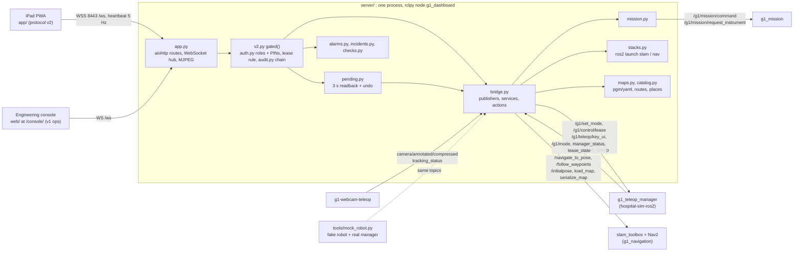

# hospital-sim-ui: iPad app, console and UI server

This repository is the operator user interface of the hospital G1. It has three parts. The iPad PWA for theatre
staff is in `app/`. The engineering console for developers is in `web/`. The aiohttp + rclpy server in
`server/` serves both and talks ROS 2.

The server needs the sibling repository `hospital-sim-ros2`. It uses the
`g1_interfaces` messages and services, the maps in `g1_navigation/maps`, the mission configuration in
`g1_mission/config` and the zones of `g1_teleop_manager`. The mock robot also needs `g1-mujoco-sim` (world and
stubs) and `hospital-sim-env` (`objects/catalog.json`, layout). The camera stream and the tracking status come
from `g1-webcam-teleop`.

The master repository `hospital-sim` checks out all of these repositories side by side. Its file `env.sh` sets
`HG1_ROOT` and sources ROS 2 Humble, the shared `.venv` and the `ros2_ws` overlay. The file
`dashboard.launch.py` in `g1_bringup` runs the server. You can also run the server by hand.

Run the commands in this README from the root of the master checkout. Paths are relative to this repository,
unless they name a sibling repository (`ros2_ws/src/hospital-sim-ros2/...`) or a master file (`env.sh`,
`docs/interfaces.md`, `docs/ui/README.md`).

The table lists the URLs that the server serves.

| URL | What | Who |
|---|---|---|
| `https://<robot>:8443/` | iPad app (`app/`, protocol v2 + v2.1: roles, Stop/Resume, alarms, send-to, instruments) | theatre staff, operators, technicians |
| `https://<robot>:8443/console/` | G1 Console, the engineering dashboard (`web/`, protocol v1 ops) | developers |
| `http://127.0.0.1:8080/` and `/console/` | the same over plain HTTP, loopback only (development on the robot PC; clients there sign in as `--localhost-role`, default technician) | developers |

The protocol is in [PROTOCOL.md](PROTOCOL.md) (v1 console ops + v2 app ops). The design brief is
`docs/ui/README.md` in the master repository. The app details are in [app/README.md](app/README.md) and
[app/DESIGN.md](app/DESIGN.md).

## How it works

The command `python hospital-sim-ui/server` runs `server/__main__.py`. It parses the options and calls
`rclpy.init()`. It builds `Dashboard` (`server/app.py`) and `RosBridge` (`server/bridge.py`, the rclpy node
`g1_dashboard`), and spins the bridge in its own thread. Then aiohttp listens on plain HTTP 8080, bound to
127.0.0.1 when TLS is set up. When `server/tls/out/server.{crt,key}` exist, aiohttp also listens on HTTPS 8443.
One process holds one ROS node.

The function `make_app` in `app.py` defines the routes:

- `/` serves `app/` (the iPad PWA);
- `/console/` serves `web/`;
- `/ws` is the single WebSocket;
- `/stream/camera.mjpg` and `/stream/head_camera.mjpg` are MJPEG streams;
- `/api/camera/snapshot.jpg`, `/api/head_camera/snapshot.jpg`, `/api/maps/<name>.png`, `/api/health` and
  `/api/incidents/<id>.zip` are HTTP endpoints;
- `/tls/ca.crt` is the robot CA for the iPad.

On connect, the server sends `hello` (protocol, modes, legal transitions, key table, limits) and the last 400
log lines. Then it pushes `state` at 2 Hz, `pose` at 10 Hz and `scan` at 5 Hz. It pushes `map` when `/map`
changes (at most 1 Hz, as a PNG), and `path` at up to 2 Hz. It pushes `mode` on every `/g1/mode` message and
`mission` on every `/g1/mission/status` message. The browser sends JSON frames `{"op": ..., "id": ...}`.

Every op goes through `V2Mixin.gated` in `server/v2.py`. The module `server/auth.py` checks the per-role
allow-list `OP_ROLE`, where clinical < operator < technician. The PINs are stored as PBKDF2-SHA256 hashes in
`server/config/auth.yaml`, and an idle session falls back to clinical. The lease rule refuses manual-motion
keys from a device that does not hold `/g1/control/lease`. The module `server/audit.py` appends the op to the
hash-chained file `audit.jsonl`. It coalesces the high-rate `key` and `cmd_vel` ops to one line per client per
second.

Commands reach the robot through `bridge.py`. A mode change calls the `/g1/set_mode` service, and the server
returns the answer of the mode manager as a toast. The bridge publishes mode manager keys on
`/g1/teleop/key_ui` as `{"key","holder"}`, the camera-node keys `c f h u` on `/g1/teleop/key`, and velocities
on `/g1/cmd_vel_teleop`. It relays the heartbeat of the app (about 5.5 Hz) on `/g1/ui/heartbeat`. The mode
manager holds the robot if the heartbeat stops for 1 s in LOCO or MANIP.

The module `server/pending.py` holds `send_to` and `instrument_request` for 3 s, with a spoken readback and an
Undo. Then it dispatches them as a Nav2 `NavigateToPose` goal or a `/g1/mission/request_instrument` call. The
module `server/mission.py` makes that call; it also serves `/g1/mission/command` and the on-demand head camera
with the target instrument overlay.

The module `server/alarms.py` evaluates a state snapshot once a second and
drives `/g1/indicator/light` and `/g1/speech/say`. A High alarm latches until it is acknowledged; Medium and
Low alarms clear with the condition. The module `server/incidents.py` keeps a 5 min ring buffer of modes,
commands, alarms and status, and zips it on "Send problem to technician".

The module `server/stacks.py` runs and stops `ros2 launch g1_navigation slam.launch.py` and `nav.launch.py` as
process groups. The module `server/maps.py` reads and writes the map_server `pgm/yaml` files and the waypoint
routes in `ros2_ws/src/hospital-sim-ros2/g1_navigation/maps/`. The module `server/catalog.py` merges places,
instruments and zones from `g1_mission/config`, `hospital-sim-env/objects/catalog.json`, `/sim/objects` and
the display overlays in `server/config/`. The module `server/checks.py` produces the start-of-day check list.

The front ends have no build step: they are plain ES modules with no CDN. The file `js/client.js` of the app is
the only place that sends ops. The service worker `sw.js` caches only the app shell. The script
`tools/mock_robot.py` publishes the contract topics of a running simulator, controller and camera teleop, and
runs the real `g1_teleop_manager` in-process. So you can exercise the whole UI, slam_toolbox and Nav2 on a
laptop without the simulator.

## Architecture



The table lists the main modules and scripts of this repository.

| Piece | File | Role |
|---|---|---|
| Entry point | `server/__main__.py` | options, rclpy init, HTTP 8080 + HTTPS 8443 sites, shutdown |
| Web app and hub | `server/app.py` | aiohttp routes, WebSocket clients, v1 ops, state broadcast, MJPEG streams |
| v2 ops | `server/v2.py` | sessions, lease, Stop/Resume/Power off, alarms, undo, places, instruments, checks, handover, incidents, audit; `gated()` wraps every op |
| Auth | `server/auth.py` | roles, PBKDF2 PINs and badges, idle timeouts, `OP_ROLE` allow-list; CLI `hash` and `set-pin` |
| ROS bridge | `server/bridge.py` | all subscriptions, publishers, service and action clients; state snapshot for the UI |
| Mission | `server/mission.py` | mission status and commands, instrument requests, head camera MJPEG with overlay |
| Pending | `server/pending.py` | 3 s undo window for send-to and instrument requests |
| Alarms | `server/alarms.py` | alarm catalogue, latching rules, acknowledge, suppress, light and speech |
| Audit | `server/audit.py` | append-only hash-chained `audit.jsonl`, `verify`, rotation, flock for shared files |
| Incidents | `server/incidents.py` | 5 min ring buffer, zip bundle per incident |
| Checks | `server/checks.py` | start-of-day check items from the state snapshot |
| Catalog | `server/catalog.py` | places, instruments and zones from sibling configs plus display overlays |
| Maps | `server/maps.py` | map_server pgm/yaml, previews, waypoint routes |
| Stacks | `server/stacks.py` | `ros2 launch` subprocess groups for SLAM, navigation and the mock |
| TLS | `server/tls/make_cert.py`, `make_cert.sh` | local CA and server certificate into `server/tls/out/` |
| iPad app | `app/index.html`, `app/js/*`, `app/sw.js`, `app/manifest.webmanifest` | PWA; one module per screen in `app/js/screens/` |
| Console | `web/index.html`, `web/js/*`, `web/js/pages/*` | engineering dashboard pages |
| Mock robot | `tools/mock_robot.py` | fake odom, scan, camera, tracking, battery; real manager in-process; e-stop, light and speech stubs |
| End-to-end checks | `tools/v2_check.py`, `tools/sim_hold_check.py`, `app/tests/*.py` | protocol and sim checks, Playwright flows |

## Dependencies

Everything runs in the shared `.venv` of the master repository. The `.venv` uses system Python 3.10.12 with
system site-packages, so that rclpy works. The pip versions are from the `.venv` freeze (`venv_local.txt`).
Packages marked apt are Ubuntu or ROS system site-packages, and they are not in that freeze.

The system dependencies are:

| Item | Version | Why |
|---|---|---|
| Ubuntu | 22.04.5 LTS | |
| ROS 2 Humble | apt `ros-humble-desktop` 0.10.0 | `rclpy`, `std_msgs`, `sensor_msgs`, `geometry_msgs`, `nav_msgs`, `rosgraph_msgs`, `rcl_interfaces`, `builtin_interfaces`, `std_srvs`, `tf2_ros` (`ros-humble-tf2-ros-py` 0.25.23) |
| Nav2 | apt `ros-humble-navigation2`, `ros-humble-nav2-bringup`, `ros-humble-nav2-msgs` 1.1.20 | `NavigateToPose`, `FollowWaypoints`, `LoadMap`; started through `g1_navigation/nav.launch.py` |
| slam_toolbox | apt `ros-humble-slam-toolbox` 2.6.10 | `SerializePoseGraph`; started through `g1_navigation/slam.launch.py` |
| `rmw_cyclonedds_cpp` | apt 1.3.5 | set by `env.sh` |
| `unitree_hg` | from `ros2_ws` | `LowState` (motor temperatures), `BmsState` (battery); optional |
| `g1_interfaces`, `g1_teleop_manager`, `g1_navigation`, `g1_mission` | `ros2_ws` (hospital-sim-ros2), `colcon build` | `Mode`, `SetMode`, `ControlLease`, `RequestInstrument`; the manager the mock runs; `scripts/rasterize_world.py`; configs |
| `g1_mujoco_sim` | `ros2_ws` (hospital-sim-ros2) and `g1-mujoco-sim/hospital_g1.xml` | stubs and world for the mock |
| colcon, vcstool | apt `python3-colcon-common-extensions`, `python3-vcstool` | build `ros2_ws`, check out the stack |

The Python dependencies are the third-party imports of `server/`, `tools/` and `app/tests/`:

| Package | Version | Used by |
|---|---|---|
| `aiohttp` | 3.14.3 | server (HTTP, WebSocket, MJPEG), `tools/v2_check.py`, `tools/sim_hold_check.py` |
| `PyYAML` | 6.0.3 | `auth.py`, `catalog.py`, `maps.py`, `bridge.py` |
| `numpy` | 1.26.4 | `bridge.py` (scan, map), `maps.py`, `mission.py`, `mock_robot.py` |
| `opencv-contrib-python` | 4.10.0.84 | `mission.py` head-camera JPEG and overlay (imported when a stream opens) |
| `Pillow` | 9.0.1, apt `python3-pil` | `maps.py` map PNG previews, `mock_robot.py` synthetic camera frames |
| `cryptography` | 3.4.8, apt `python3-cryptography` | `server/tls/make_cert.py` |
| `playwright` | 1.63.0 (+ `playwright install webkit`) | `app/tests/flows.py`, `screens.py`, `sim_e2e.py` (WebKit, iPad Pro 11 profile) |
| `pytest` | 6.2.5, apt `python3-pytest` | `server/tests` |
| `rclpy` and the ROS message packages above | ROS Humble apt | `bridge.py`, `mission.py`, `mock_robot.py` |

The file `requirements.txt` at the repository root pins the pip packages and lists the apt ones in a comment.

The data and assets that are not in git are:

| Asset | Where it comes from |
|---|---|
| Saved maps `<name>.pgm/.yaml`, `.posegraph/.data`, `<name>.waypoints.json` | written by the server into `ros2_ws/src/hospital-sim-ros2/g1_navigation/maps/` (that package's README lists the committed ones) |
| TLS material `server/tls/out/{ca.key,ca.crt,ca.pem,server.key,server.crt}` | `server/tls/make_cert.sh`; gitignored |
| Runtime data `server/audit/audit.jsonl`, `server/incidents/*.zip`, `server/data/checks.jsonl` | written by the server; gitignored; `--data-dir` moves them |
| Playwright WebKit browser | `playwright install webkit` into `PLAYWRIGHT_BROWSERS_PATH` |

## Install

Run these commands from a fresh clone of `hospital-sim`, after `vcs import < hospital-sim.repos`.

```bash
source env.sh
.venv/bin/pip install -r hospital-sim-ui/requirements.txt
(cd ros2_ws && colcon build --symlink-install) && source env.sh      # g1_interfaces, g1_teleop_manager, g1_navigation, g1_mission
hospital-sim-ui/server/tls/make_cert.sh                             # local CA + server cert for HTTPS/WSS 8443 (no sudo)
.venv/bin/playwright install webkit                                  # only for app/tests
```

Without certificates, the server serves plain HTTP only (on `--host`) and prints a warning.

### iPad setup (HTTPS, once per robot)

The iPad talks to the robot only over HTTPS/WSS. Safari needs a secure context for Wake Lock, speech and
getUserMedia (`docs/ui/02_standards_and_deployment.md` L-4). The robot runs its own small certificate authority
until the hospital CA is used.

1. On the robot PC, run `hospital-sim-ui/server/tls/make_cert.sh`. It creates
   `server/tls/out/{ca.crt, ca.key, server.crt, server.key}`. The server certificate covers `localhost`, the
   hostname, `<hostname>.local` and every LAN IPv4 address. Run the script again when the IP of the robot
   changes; the CA is kept, so the iPads keep trusting it. The option `--names robot.local 10.0.0.5` adds
   names; `--new-ca` makes a new CA.
2. Copy `ca.crt` to the iPad. Use one of these ways:
   - AirDrop the file;
   - e-mail it as an attachment and tap it in Mail;
   - open `https://<robot-ip>:8443/tls/ca.crt` in Safari once and accept the warning that one time.
3. On the iPad, open Settings > General > VPN & Device Management and install the "G1 robot local CA" profile.
   On older iPadOS, the profile is under "Profile Downloaded" at the top of Settings.
4. Open Settings > General > About > Certificate Trust Settings and switch on full trust for
   "G1 robot local CA".
5. Open `https://<robot-ip>:8443/` in Safari, then Share > Add to Home Screen. The app then runs full screen.

In a hospital, the iPads are supervised. MDM pushes the hospital-CA certificate and the web clip or WKWebView
wrapper (02 D-1). The server prints its URLs when it runs.

## Run

```bash
source env.sh
ros2 launch g1_bringup sim.launch.py world:=hospital viewer:=false   # terminal 1: MuJoCo sim + controller + manager
ros2 launch g1_bringup dashboard.launch.py                          # terminal 2: this server; https://<host>:8443/ and /console/, http://127.0.0.1:8080/
python hospital-sim-ui/server --use-sim-time true                   # the same by hand
```

The command `ros2 launch g1_bringup all.launch.py` runs the simulator, SLAM, Nav2-on-SLAM and the dashboard
together. The dashboard then shows those stacks as "external". The command
`ros2 launch g1_bringup mission.launch.py fixed_base:=true` runs the scrub-nurse mission on the simulator for
the instrument flows of the app.

Without the simulator, use the mock robot. It fakes the scan, odom, camera and tracking, and runs the real mode
manager in-process:

```bash
ros2 launch g1_bringup dashboard.launch.py mock:=true     # or: python hospital-sim-ui/server --mock
```

The real slam_toolbox and Nav2 run against the mock. So you can demonstrate the whole flow of mapping, saving,
localising and navigating on a laptop. The mock runs the real `g1_teleop_manager`, so HOLD, lease, watchdog,
e-stop interlock and zones behave as on the robot. It also runs the e-stop, light and speech stubs. The option
`--mock-arg --no-estop` gives no e-stop heartbeat, so motion is locked. The option
`--mock-arg --dev-ignore-estop` sets the DEV override.

The table lists the server options (`python hospital-sim-ui/server --help`).

| Option | Default | Meaning |
|---|---|---|
| `--port`, `--https-port` | 8080, 8443 | plain HTTP and HTTPS ports |
| `--host`, `--http-host` | `0.0.0.0`, `127.0.0.1` when TLS is set up | bind addresses |
| `--no-tls` | | plain HTTP only |
| `--localhost-role clinical\|operator\|technician` | technician | role of loopback clients |
| `--auth-config` | `server/config/auth.yaml` | PIN hashes and role settings |
| `--undo-s` | 3.0 | undo window |
| `--data-dir` | `server/` | where `audit/`, `incidents/`, `data/` live; use one per server instance |
| `--use-sim-time true\|false` | true | `/clock` for this node and the stacks it starts |
| `--maps-dir` | `ros2_ws/src/hospital-sim-ros2/g1_navigation/maps` | saved maps |
| `--key-repeat-ms` | 250 | browser re-send period for held keys (manager timeout 500 ms) |
| `--mock`, `--mock-arg ...` | | start `tools/mock_robot.py` as a child |

Use a private `ROS_DOMAIN_ID` when several people or simulators share the machine.

### Roles, PINs (test defaults) and control

The table lists the roles and their test PINs.

| Role | Sign in | Falls back to Clinical | Can do |
|---|---|---|---|
| Clinical | nothing (walk-up) | never | Stop, Resume, Power off, Send to, Request instrument, Cancel, acknowledge alarms, send problem to technician, checks (nurse part) |
| Operator | PIN `123456` (role PIN) or personal PIN, for example R. Kumar `246810` / badge `04A1B2C3` | 10 min idle | plus take control (lease), manual walking and arms, map goals, routes, missions |
| Technician | PIN `987654`, or T. Lee `135790` / badge `04D4E5F6` | 5 min idle | plus mapping, stacks, audit log, incidents, alarm stats, suppress Low alarms |

The PINs live as PBKDF2 hashes in `server/config/auth.yaml`.

CAUTION: Change the PINs before any real use.

Run `python hospital-sim-ui/server/auth.py set-pin operator <new>` to set a PIN. The setting
`two_factor: true` makes technicians use badge plus PIN. The server enforces the op allow-list (the v2 table in
PROTOCOL.md) for every WebSocket op. Refused ops go to the audit log.

- Stop requests mode HOLD from every device and every role, with no lease needed. In HOLD the task is paused,
  the arms are frozen and the robot keeps balancing. Resume (a slide in the app) returns to standing or
  continues the paused task. Power off requests DAMP, and the robot sinks.
- The control lease lets one device drive by hand at a time (`lease_acquire`, or `lease_steal` with a reason).
  The app sends a heartbeat at 5 Hz or more. If the driving iPad is silent for more than 1 s in manual walking
  or arms, the mode manager holds the robot.
- The hardware e-stop locks the motion modes until its heartbeat (`/g1/estop/heartbeat`) is seen. The simulator
  and the mock publish a stub. The command `ros2 service call /sim/estop std_srvs/srv/SetBool "{data: true}"`
  presses it.
- The runtime files are the audit log `server/audit/audit.jsonl` (append-only, hash-chained), the incidents
  `server/incidents/*.zip` and the start-of-day records `server/data/checks.jsonl`. All of them are gitignored.

## Test / check

```bash
source env.sh
.venv/bin/python -m pytest hospital-sim-ui/server/tests -q            # 68 passed (confirmed 2026-10-10)
python hospital-sim-ui/tools/v2_check.py                              # 64 protocol checks against the mock or the sim; exit 0 = all passed
python hospital-sim-ui/tools/sim_hold_check.py [--full]               # 33 checks on the MuJoCo sim with mission.launch.py fixed_base:=true
```

The script `v2_check.py` drives three simulated iPads over the WebSocket. It checks roles, lease, Stop to HOLD
and resume, the UI heartbeat watchdog, undo, alarms, the audit chain and an incident. The script
`sim_hold_check.py` requests an instrument and presses Stop during the pick. It measures the arm and waist
drift from `/joint_states`, which must stay below 0.02 rad over 3 s. Then it resumes, trips the watchdog, and
checks the lease and role refusals.

The app tests use Playwright WebKit with the iPad Pro 11 profile. Run them against a server that you ran with
`--mock --no-tls --port 8174 --localhost-role clinical`:

```bash
export PLAYWRIGHT_BROWSERS_PATH=<scratch>/pw PLAYWRIGHT_SKIP_VALIDATE_HOST_REQUIREMENTS=1
python hospital-sim-ui/app/tests/flows.py   --url http://127.0.0.1:8174      # F1-F5 scripted flows, PASS/FAIL per check
python hospital-sim-ui/app/tests/sim_e2e.py --url http://127.0.0.1:8174      # server + mission.launch.py fixed_base:=true
python hospital-sim-ui/app/tests/screens.py --url http://127.0.0.1:8174      # screenshots of every screen -> app/docs/screenshots/
python hospital-sim-ui/app/tests/a11y.py                                    # contrast, touch targets, names -> app/docs/a11y_report.md
```

The recorded results are under "Tested" below.

## Layout

The table lists the files and folders of this repository.

| Path | What |
|---|---|
| `server/__main__.py` | entry point: `python hospital-sim-ui/server` |
| `server/app.py` | aiohttp + WebSocket hub, v1 ops, MJPEG |
| `server/v2.py` | v2 ops; `gated()` role, lease and audit wrapper |
| `server/auth.py`, `alarms.py`, `audit.py`, `pending.py`, `incidents.py`, `catalog.py`, `checks.py` | roles and PINs; alarms; hash-chained log; undo; incident bundles; places, instruments, zones; start of day |
| `server/bridge.py` | rclpy node `g1_dashboard` |
| `server/mission.py` | mission status, commands, requests; head camera with overlay |
| `server/stacks.py` | `ros2 launch` subprocesses (SLAM, navigation, mock) |
| `server/maps.py` | map_server pgm/yaml, previews, routes |
| `server/config/` | `auth.yaml` (PIN hashes), `places.yaml`, `instruments.yaml` (display metadata) |
| `server/tls/` | `make_cert.sh`, `make_cert.py` (local CA + server cert) into `tls/out/` (gitignored) |
| `server/tests/` | unit tests, no ROS: `test_v2_units.py`, `test_v2_needs.py` |
| `server/audit/`, `server/incidents/`, `server/data/` | runtime data, gitignored |
| `app/` | iPad app: `index.html`, `manifest.webmanifest`, `sw.js`, `VERSION`, `css/{tokens,app}.css`, `icons/`, `js/*.js`, `js/screens/*.js`, `tests/`, `docs/` (screenshots, a11y report), `README.md`, `DESIGN.md`, `NEEDS_FROM_BACKEND.md` |
| `web/` | console: `index.html`, `css/app.css`, `js/{main,robot,ui,mapview,teleop}.js`, `js/pages/{dashboard,mapping,navigation,teleop,mission,logs}.js`, `img/` |
| `tools/mock_robot.py` | mock G1 (world rasterised from `g1-mujoco-sim/hospital_g1.xml`, or `--layout`) |
| `tools/v2_check.py`, `tools/sim_hold_check.py` | end-to-end checks |
| `PROTOCOL.md` | WebSocket protocol v1 + v2 |
| `requirements.txt` | pip pins for the shared `.venv` |
| `docs/screenshots/` | console screenshots (`sim_*` = MuJoCo sim, `mock_*` = mock robot) |

## Interfaces to other repositories

The contract is `docs/interfaces.md` in the master repository (sections 3, 5 and 6).

This repository reads from the siblings:

| From | What |
|---|---|
| `hospital-sim-ros2` | `g1_interfaces` (`msg/Mode`, `srv/SetMode`, `srv/ControlLease`, `srv/RequestInstrument`); `g1_navigation/maps/` (read and write), `g1_navigation/scripts/rasterize_world.py` (mock); `g1_mission/config/{locations,instruments}.yaml`; `g1_teleop_manager/config/zones.yaml` and the `ManagerNode` class (mock); launch files `g1_navigation/{slam,nav}.launch.py` |
| `g1-mujoco-sim` | `hospital_g1.xml` (mock world), `g1_mujoco_sim.stubs` (e-stop, light, speech stubs) |
| `hospital-sim-env` | `objects/catalog.json` (rack slots, world poses); `isaac/scene/layout.py` rooms (mock `--layout`, app floor plan) |
| `g1-webcam-teleop` | `/g1/teleop/camera/annotated/compressed` (960x540 JPEG) and `/g1/teleop/tracking_status` |

The ROS topics and services are:

| Direction | Names |
|---|---|
| Subscribed | `/g1/mode` (transient local), `/g1/controller/status`, `/g1/teleop/tracking_status`, `/g1/teleop/manager_status`, `/g1/teleop/camera/annotated/compressed`, `/g1/control/lease_state`, `/g1/estop/heartbeat`, `/g1/mission/status`, `/map` (transient local), `/scan`, `/odom`, `/tf`, `/plan`, `/amcl_pose`, `/rosout`, `/sim/status`, `/sim/objects`, `/battery_state`, optional `/lowstate` (motor temperatures) and `/lf/bmsstate` (battery); `/g1/head_camera/image_raw` and `/g1/perception/detections` only while a head-camera stream is open |
| Published | `/g1/teleop/key` (camera-node keys `c f h u`), `/g1/teleop/key_ui` (`{"key","holder"}`), `/g1/cmd_vel_teleop`, `/g1/ui/heartbeat` (`{"holder","seq"}`), `/g1/teleop/arms_hold`, `/g1/teleop/hand_override`, `/initialpose`, `/g1/indicator/light`, `/g1/speech/say`, `/g1/mission/command` |
| Services and actions | `/g1/set_mode`, `/g1/control/lease`, `/g1/mission/request_instrument`, `/navigate_to_pose`, `/follow_waypoints`, `/map_server/load_map`, `/slam_toolbox/serialize_map` |

The ports (`docs/interfaces.md` section 5) are 8443 and 8080. Port 8443 is HTTPS + WSS (app at `/`, console at
`/console/`). Port 8080 is plain HTTP, bound to 127.0.0.1 when TLS is set up.

## Console pages

The table lists the pages of the console.

| Page | What it does |
|---|---|
| Dashboard | mode card with the legal next transitions, controller status (policy, placeholder, fall, loop Hz), pose and speed, battery and hottest joint (when published), live map, teleop camera, SLAM and Nav2 stack state, data-link health, recent events |
| Mapping | Start and Stop SLAM (slam_toolbox online async), live map + laser scan + trail, Ready, Start locomotion and Pause buttons, browser keyboard (W A S D Q E, Space) and a virtual joystick (vx + wz, or vy with "strafe"), Save map |
| Navigation | saved maps with previews (SLAM maps and the labelled ground-truth map), Localise (map_server + AMCL + Nav2) or "Use SLAM map" (Nav2 while mapping), Stop; map tools: Initial pose, Go to (click-drag for heading), Add waypoint; mission state with distance, ETA and recoveries, Pause, Resume, Cancel, Back to STAND; waypoint list to Run or Save as task; saved tasks per map |
| Teleoperation | the exclusive mode flow DAMP > STAND > LOCO > (p) STAND > MANIP > (n) STAND, plus NAV; buttons for every contract key; keyboard capture with the same bindings; locomotion pad + joystick; camera teleop preview (MJPEG) with hand-visible and auto-framing indicators, calibration state, per-hand confidence, latency, PTZ angles; Calibrate (c), Auto-framing (f), Re-centre (h), Clear calibration (u); mode-manager status (output cmd_vel, last key, last message) |
| Mission | scrub-nurse mission (g1_mission): state + current step, Start, Pause, Resume, Abort, Ready (r) and Override (p) shortcuts, Go-to a named location; instrument request buttons (target highlighted, queue positions), live behaviour tree with node statuses and feedback, head camera on demand (MJPEG, target instrument highlighted, "GT (cheat)" labels on every ground-truth source), request history |
| Logs | `/rosout`, SLAM and Nav2 launch output, dashboard events; level filter, search, auto-scroll, download |

The keyboard (`docs/interfaces.md` 3.3) is active on the Mapping and Teleoperation pages (toggle in the page).
The key `x` (power off) works on every page. The table lists the keys.

| Key | Action | Key | Action |
|---|---|---|---|
| `r` | DAMP to STAND, also HOLD to STAND (resume) | `w`/`s` | forward / back (LOCO only) |
| `l` | STAND to LOCO | `a`/`d` | strafe left / right (LOCO only) |
| `p` | LOCO/NAV/AUTO to STAND | `q`/`e` | turn left / right (LOCO only) |
| `o` | Stop: any to HOLD | `space` | zero velocity |
| `m` | STAND to MANIP | `x` | power off (any to DAMP) |
| `n` | MANIP to STAND | `c` `f` `h` `u` | camera teleop node: calibrate, framing, re-centre, clear calibration (Teleoperation page) |
| `g` | STAND to NAV | | |

The console respects the contract in this way. Mode keys go through the `SetMode` service. So the console shows
the answer of the mode manager (accepted, or rejected with a reason) as a toast. For example, the mode manager
rejects LOCO to MANIP, and the toast tells the operator to pause first.

The console sends `r`, `p` and `n` only in the modes where they mean something. It sends movement keys and the
joystick only in LOCO. It re-sends a held key every 250 ms; the mode manager key timeout is 0.5 s, and the step
is 0.1 m/s per key. It sends `space` when all keys are released.

A navigation goal first requests STAND to NAV. If the robot is in LOCO or MANIP, the mode manager rejects this
and the console does not send the goal. Closing the last browser tab publishes a zero `/g1/cmd_vel_teleop`.


## Tested

- v2 (2026-09-30): `tools/v2_check.py` passed 50/50 against the mock and against the MuJoCo simulator
  (`mission.launch.py fixed_base:=true`). `tools/sim_hold_check.py` passed 24/24. Stop during the scalpel and
  Adson forceps pick reached HOLD in 12 to 27 ms. The arm + waist drift over the next 3 s was 0.0097 / 0.0045
  rad. The arm was moving at 0.24 / 0.20 rad/s when stopped. The hands were unchanged, the mission paused,
  resume went to AUTO, and the handover finished (`--full`).
- v2 (continued): the watchdog tripped in 0.92 to 0.94 s; a non-lease iPad was refused; Clinical was refused a
  Technician op. The unit tests passed 59 at the time (68 today). The console (v1) flow r, l, w, p, m, n, x
  still works through the v2 gate, with its new heartbeat.
- v2.1 (NEEDS_FROM_BACKEND 1-9): `v2_check.py` passed 64/64 on the mock. `sim_hold_check.py` passed 33/33
  twice on the simulator. The new checks are:
  - the ground-truth map pose;
  - the task sentence;
  - proximity from `/scan`;
  - arms hold in MANIP while a teleop stream keeps running;
  - gripper override close and open;
  - arms follow again.

  The drift during arms hold was 0.007 rad at 0.19 rad/s, and 0.024 rad (0.009 after 0.3 s) at
  0.55 rad/s. The angled_tweezers task with Stop and resume at pick-lift, carry, glide, presentation and
  wait-for-grip handed over 6/6.
- Mission page (2026-09-30): the setup was the MuJoCo simulator with the `hospital-sim-env/objects/` theatre,
  `mission.launch.py fixed_base:=true dashboard:=true` and headless Chrome. Ready (r) went to STAND. An
  instrument button started the mission (AUTO). The live tree and the head camera on demand with the target
  overlay worked, with no console errors. Pick, carry, handover, back to table and the history entry worked
  for two instruments in a row. The screenshots are `docs/screenshots/sim_mission_*`.
- MuJoCo simulator (`sim.launch.py world:=hospital`, placeholder policy): from the browser and the WS API, the
  robot went DAMP to STAND to LOCO. It drove about 60 m through the corridor, link and rooms with `cmd_vel`
  while slam_toolbox mapped, and the map `hospital_wing_slam` was saved. After SLAM stopped, AMCL localised on
  the saved map (initial pose). A NAV goal 14 m down the corridor succeeded (154 s, 3 recoveries). A
  2-waypoint task into the link room and back succeeded (110 s). The screenshots are `docs/screenshots/sim_*`.
- Browser keyboard test (headless Chrome, same simulator run): passed with no console errors. The sequence
  was `l`; hold `w`; `m` in LOCO, which gave the rejection toast of the mode manager; `p`; `m` to MANIP; `w`,
  which was ignored with a hint; `n` to STAND.
- Mock robot: SLAM mapping (layout world), save, AMCL + Nav2 goal and a 3-waypoint task with pause and resume
  passed. In the sim-hospital world, SLAM + "Use SLAM map" Nav2 goals passed, and the camera and tracking
  panels and the calibrate key worked. The screenshots are `docs/screenshots/mock_*`.
- The iPad app flows, the simulator end-to-end test and the accessibility results are in
  [app/README.md](app/README.md) "Results".

These items are not tested:

- `all.launch.py` (only `sim.launch.py` + `dashboard.launch.py` were used);
- the real G1;
- the real OBSBOT camera stream into the dashboard (only the mock camera; the format matches
  `g1-webcam-teleop`, 960x540 JPEG);
- `/lowstate` temperatures and battery with real values (the simulator publishes zeros and no BMS);
- `nav2_msgs/LoadMap` hot-swap while AMCL runs (the UI falls back to restarting the stack);
- phones and touch screens (the layout is responsive; the joystick uses pointer events);
- a real iPad (WebKit desktop with the iPad Pro 11 viewport and user agent was used).

Nothing is deployed on a real robot.

## Known issues

- slam_toolbox 2.6.10 (the Humble binary) fails to serialize its pose graph here ("Failed to write file:
  Exception output stream error"). The server saves the pgm/yaml map regardless, and the toast says so.
- The placeholder locomotion policy drifts while standing (about 1 m per minute in STAND and NAV-idle) and
  turns in place slowly. So Nav2 needs a few recovery spins at the start of a goal.
- The WebKit build of Playwright on this Ubuntu 22.04 box needs libraries that are not installed and cannot be
  installed without sudo. They were fetched with `apt-get download` (jammy debs, extracted). Two libraries
  with no jammy package (`libjxl.so.0.8`, `libbacktrace.so.0`, used only for JPEG-XL decoding and crash
  backtraces) were replaced by empty stub libraries. All were copied into the scratch WebKit bundle. The app
  never uses JPEG-XL.
