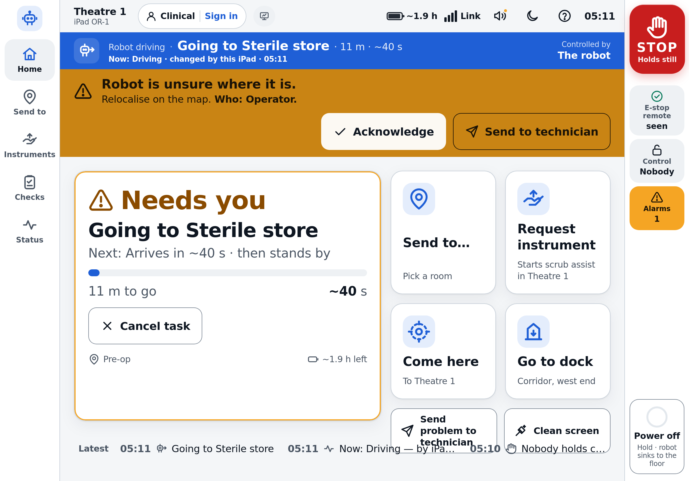

# G1 Theatre: the iPad app

The iPad controller for the Unitree G1 in the surgical wing. It is for theatre staff (Clinical), operators and
technicians, and implements the 15 decisions in [`docs/ui/README.md`](../../docs/ui/README.md). It talks to the robot
through `hospital-sim-ui/server` using protocol v2 + v2.1 ([`hospital-sim-ui/PROTOCOL.md`](../PROTOCOL.md)). The engineering console (`hospital-sim-ui/web`, v1)
stays at `/console/`.



- Installable PWA: manifest, icons, a service worker that caches **the app shell only** (robot state is never
  cached), standalone display, safe-area insets, pre-paint theme so Theatre dim never flashes white.
- No build step, no libraries, no web fonts, no CDN. Plain ES modules; SF Pro via `system-ui` on the iPad.
- Landscape-first for iPad 11" / 13"; a portrait layout for the ward operator walking with the robot.
- No patient data anywhere. Cameras are live only (MJPEG from the server); nothing is recorded or stored by the app.

## Run it

```bash
source env.sh
export ROS_DOMAIN_ID=74                                   # your own domain
python hospital-sim-ui/server --mock                                   # mock robot + the real mode manager, in-process
# or against the MuJoCo sim + scrub-assist mission:
ros2 launch g1_bringup mission.launch.py fixed_base:=true &
python hospital-sim-ui/server --use-sim-time true
```

Open `http://127.0.0.1:8080/` on the robot PC (loopback clients start as Technician unless you pass
`--localhost-role clinical`), or `https://<robot>:8443/` from an iPad. Use `--data-dir <dir>` when you run a second
server on the same machine, so audit logs and incidents do not mix.

Test PINs (from `hospital-sim-ui/server/config/auth.yaml`, **change before any hospital use**): Operator `123456`,
Technician `987654` (personal PINs: R. Kumar `246810`, T. Lee `135790`).

## Open it on a real iPad over Wi-Fi (HTTPS)

Safari needs a secure context for Wake Lock, speech and the service worker, and the app only uses `wss://`.

1. On the robot PC: `hospital-sim-ui/server/tls/make_cert.sh` (local CA + server certificate for the PC's names/IPs; add names
   with `--names robot.local 10.0.0.5`).
2. Put `hospital-sim-ui/server/tls/out/ca.crt` on the iPad: AirDrop, e-mail attachment, or open
   `https://<robot-ip>:8443/tls/ca.crt` once in Safari.
3. iPad **Settings → General → VPN & Device Management** → install the profile, then **Settings → General → About →
   Certificate Trust Settings** → full trust for "G1 robot local CA".
4. Safari → `https://<robot-ip>:8443/` → **Share → Add to Home Screen**. The icon "G1 Theatre" opens full screen
   (standalone), with the status bar over the dark or light app background.
5. First launch: tap the speaker icon in the status bar and do the **sound check** (iPads cannot report their volume;
   audio is unlocked on that tap with `navigator.audioSession.type = 'playback'` so the silent switch does not mute
   alarm tones). The robot's own speaker stays the primary alarm channel.
6. Settings (tap the room name top left, as Technician) set the device name and where the iPad is mounted, which is
   where "Come here" sends the robot.

### Hospital deployment (MDM, Guided Access)

- Theatre iPads should be **supervised** and managed by MDM (Jamf / Intune / Workspace ONE) in **Single App Mode**,
  preferably through a thin WKWebView wrapper (managed config: robot URL, room, device name; certificate pinning).
  MDM pushes the hospital-CA certificate, so nobody ever accepts a certificate warning (02 D-1, L-4).
- **Guided Access** (Settings → Accessibility → Guided Access, triple-click to start) is fine for a pilot, but a user
  with the passcode can leave it; it is not enough on its own (02 D-2).
- MDM: Auto-Lock "Never" for iPads on a charging mount; Auto-Brightness on. The app also holds a **Screen Wake
  Lock** while the robot moves, while an alarm is active, and while this iPad holds manual control.
- Dedicated device VLAN, no internet egress. The app needs nothing from the internet.
- The iPad is **not** the emergency stop. A latching hardware e-stop must be within reach; the safety rail shows
  whether its heartbeat is seen.

## Screens

| Mode | Screen | What it does |
|---|---|---|
| All | **Safety rail** (right in landscape, bottom band in portrait) | **STOP** (96×120 pt, fires on `pointerdown`, one tap → HOLD: arms frozen, task paused), hardware e-stop heartbeat, who has manual control, alarm counter, **Power off** (hold 1.5 s, "robot sinks to the floor" → DAMP). Never covered by sheets, cards or the across-room view. |
| All | **Status bar** | Room, device, role chip (sign in / Done), Simulation/Mock chip, REC when the mission records, battery as time left, link bars, sound check, Light/Theatre dim, help, clock |
| All | **Mode ribbon** | Family colour + icon + words: robot driving (blue), person driving (magenta + stripes + hand), standing by (slate), stopped (red band), powered down (grey outline). "Changed by …" on every change, "Controlled by …". Red on a High alarm. |
| All | **Across-room view** | After 20 s idle: status word 88 pt, activity 64 pt, next 40 pt, progress arc. The first tap only wakes. Not shown on Walk / Arms. |
| Clinical | **Home** | Hero *now · OK? · next* (44/34/22 pt; "now" is the server's `state.task` sentence when present), progress + ETA, request stepper, live vector floor plan (in the fixed-base sim the robot comes from sim ground truth and is labelled "(simulation position)"); recovery after Stop (slide to continue the task / slide to stand / cancel task / send to technician); tiles: Send to…, Request instrument, Come here, Go to dock (each says why when blocked); Send problem to technician; Clean screen; last 3 events |
| Clinical | **Send to…** | Place tiles with a floor-plan thumbnail, theatre number stripe, ETA; one tap → readback card with a 3 s Undo ring (spoken) |
| Clinical | **Instruments** | Illustrated tiles grouped as on the tray, rack count / "with the surgeon", For: Surgeon / Scrub nurse, readback "Needle driver → surgeon, handle first" + Undo, request stepper, **handed today** list for the count. No urgent button. |
| Clinical | **Checks** | Start of day (robot checks from `checks_run`, technician stand-up slide, the ~60 s nurse part: two questions and "press Stop now" → "Stopped by you, that is right" → slide to resume), Handover card (Show big), End of shift (dock, cleaning checklist, clean-screen lock) |
| Clinical | **Status** | Now, power, location, health, control, today, blurred live camera thumbnail; Technician adds raw FSM values |
| Sheets | | Sign in (role → PIN pad), alarms list (acknowledge, technician can suppress Low), send problem to technician (chips → incident ID), manual control (take / hand back / take over with a reason), help (how-tos, what the robot does not do), settings, sound check |
| Operator | **Map** | Occupancy map with places, path, laser dots; tools: move map, go to point (tap + drag heading), robot is here (relocalise), add stops → run route; +/−/Fit/centre buttons; trip pause/resume/cancel |
| Operator | **Walk** | 1 take control (slide) → 2 start manual walking (shows and runs the legal path, e.g. "Pause the task → Manual walking") → hold-to-move joystick (220 pt) + hold buttons, speed cap (Slow 0.2 / Normal 0.3 / Fast 0.5 technician only, min with zone cap and server `manual_cap`), keyboard W A S D Q E, Done → offer to resume the paused trip |
| Operator | **Arms** | Live robot head camera (large, empty state when no frames), your hands picture-in-picture (mirrored) with L/R tracking rings, latency pill (amber > 250 ms, blocked > 500 ms), **proximity strip** from the lidar (`state.proximity`: Left / Front / Right, "clear", distance, amber < 1 m "close", red < 0.5 m "very close"), pre-flight checks (collapsed to one line while the arms are live), "Use arms" goal button, **Hold arms** (`manip_hold`, stays in MANIP) with a two-step release: *match the robot's pose* → slide to let the arms follow you (they move toward your pose at ≤ 1.5 rad/s), **hand open/close** per side (`hand`, live only while held or stopped; `not_now` shown in plain words), Finish (slide), camera re-centre / auto-framing, **seated calibration** sheet |
| Operator | **Missions** | Scrub-assist behaviour tree in plain words (done / now / next), start (slide), pause, resume, stop the task, queue, history |
| Technician | **System** | Diagnostics (mode manager, controller, interlocks, battery, stacks, sim, topic ages, 29-joint temperature table, devices, copy for incident), Mapping (SLAM start/stop, save, load, delete by hold), Logs, Audit (verify chain), Incidents (download through a one-time `incident_link`, valid 60 s), Calibration, About (versions, SOUP: none), link to `/console/` |
| Clinical | **Instruments: handed today** | times from `handover_card.instruments_handed[].t` and `mission.history[].t` |
| Operator+ | **Teach** (upcoming) | Labelled preview of define → demonstrate → review → train → test in sim (scorecard) → dry run → two-person approval → publish; "Notify me". Controls nothing. |
| All | **Clean screen** | 30 s touch lock with countdown; Stop still works with a 2 s hold |
| All | **Link lost** | Amber banner stating what the robot does (manual control holds within 1 s; a task continues), that Stop cannot reach it, and to use the hardware e-stop; ribbon/hero switch to "last known" |

Roles drop back to Clinical after 10 min (Operator) / 5 min (Technician) idle, with a 60 s warning; the server
enforces the same and the per-role op allow-list.

## Architecture

```
hospital-sim-ui/app/
  index.html               shell (grid areas), pre-paint theme script, PWA meta
  manifest.webmanifest     standalone, icons, theme colour
  sw.js                    app-shell cache only (network first); never /ws /api /stream /console
  VERSION                  reported by the server in hello.versions.app
  css/tokens.css           design tokens: Light + Theatre dim (see DESIGN.md)
  css/app.css              layout, components, portrait, reduced motion
  icons/                   app icon (SVG + PNG 180/192/512/maskable)
  js/client.js             WebSocket client, state store, protocol v2 `api` (the only place ops are sent)
  js/status.js             robot state -> plain language (now / OK? / next, families, who changed it)
  js/shell.js              safety rail, status bar, ribbon, banners, readback card, stop reason, across-room
  js/sheets.js             sign in, alarms, send problem, control lease, help, settings, sound check
  js/goals.js              goal buttons: legal FSM path (via STAND) shown and run step by step; stand-up
  js/platform.js           iPad Safari: earcons (IEC-like patterns), speech readback, Wake Lock
  js/floorplan.js          vector floor plan from hospital-sim-env/isaac/scene/layout.py rooms
  js/mapview.js            occupancy map widget (adapted from the console)
  js/data.js               built-in rooms / places / instruments / step words (server data wins)
  js/icons.js              outline icon set, drawn for this app
  js/screens/*.js          one module per screen: mount(el, ctx) -> cleanup
  tests/flows.py           F1-F5 scripted (Playwright WebKit, iPad Pro 11)
  tests/sim_e2e.py         MuJoCo sim: request instrument, Stop during the pick (arm drift), resume, handed
  tests/screens.py         every screen, Light + dim, landscape + portrait -> docs/screenshots/
  tests/a11y.py            contrast of all token pairs, touch targets, accessible names -> docs/a11y_report.md
```

Data flow: the server pushes `hello`, `state` (2 Hz), `mode`, `session`, `lease`, `alarms`, `event`, `pending`,
`mission`, `instruments`, `pose`, `map`, `path`; `store` keeps the latest of each and emits events; screens render
from `store.state` through `status.js`. Every command goes through `api` in `client.js`. A heartbeat is sent at
~5.5 Hz. Renders that sit under a finger (tiles, slides, joystick) are keyed so a 2 Hz state update never replaces a
control mid-press; the Walk screen stops sending velocity if its controls are rebuilt.

If the server does not speak protocol v2, the app says so in a banner and points to `/console/`.

## Testing

```bash
P=<scratch>; export PLAYWRIGHT_BROWSERS_PATH=$P/pw PLAYWRIGHT_SKIP_VALIDATE_HOST_REQUIREMENTS=1
python hospital-sim-ui/app/tests/flows.py   --url http://127.0.0.1:8174      # server with --mock --localhost-role clinical
python hospital-sim-ui/app/tests/sim_e2e.py --url http://127.0.0.1:8174      # server + mission.launch.py fixed_base:=true
python hospital-sim-ui/app/tests/screens.py --url http://127.0.0.1:8174      # after flows.py (it loads the map)
python hospital-sim-ui/app/tests/a11y.py
```

WebKit on this Ubuntu 22.04 box: Playwright's WebKit build needs a few libraries that are not installed and cannot
be installed without sudo. They were fetched with `apt-get download` (jammy debs, extracted) and two with no jammy
package (`libjxl.so.0.8`, `libbacktrace.so.0`, used only for JPEG-XL decoding and crash backtraces) were replaced
by empty stub libraries, all copied into the scratch WebKit bundle. WebKit then runs normally; the app never uses
JPEG-XL.

### Results (2026-09-30, re-run after v2.1)

- **Flows on the mock (v2.1 server, real manager in-process, Nav2 + AMCL on `hospital_gt`)**: 36/36 checks, plus 5 new F4b checks run on their own (16/16 for F4): Hold arms stays in MANIP with `arms_hold`, left hand closed while held, release disabled until "My arms match the robot", release → arms follow again (still MANIP), `hand` refused with `not_now` once the arms are live. F1
  stand-up slide, nurse part with the Stop press → HOLD → slide to resume; F2 readback + Undo (nothing sent), send →
  NAV after the 3 s window, blue ribbon, across-room after 20 s, first tap only wakes; F3 plain refusal when the
  mission is not running; F4a take control, goal button STAND→LOCO, magenta ribbon, joystick hold moved 0.64 m,
  0.005 m after release; F4b "Use arms" LOCO→STAND→MANIP, finish → STAND; F5 Stop → HOLD with "Stopped by you",
  slide to continue the trip → NAV, cancel, Power off ignores a short press and powers off after 1.5 s, latched
  High alarm, acknowledged. Zero console errors.
- **MuJoCo sim + mission (fixed base), v2.1**: 16/16 checks for the needle driver and 16/16 for Mayo scissors. New checks: the pose arrives from `sim_ground_truth` in the map frame and the floor plan shows the robot labelled "(simulation position)"; the hero shows the server task sentence ("Picking up the needle driver"); Stop 0.25–0.26 s, arm drift 0.0008 / 0.0010 rad over 3 s in HOLD; handed list with times. Angled tweezers: the handover failed in the sim and the live Medium `handover_failed` alarm rendered what · do · Who (`sim_alarm_request_failed_light.png`). Earlier v2 runs: needle driver and Mayo scissors requested from the Instruments screen,
  readback text exact, mission AUTO after the undo window; Stop pressed during **Pick**: HOLD seen 0.25 s after
  the tap, **arm + waist drift 0.0004 rad over 3 s** (frozen, no blend), mission paused; slide to continue → AUTO;
  instrument handed (49.6 s / 52.8 s), handed count updated. A third run (angled tweezers) was stopped and resumed
  correctly, then the mission reported "Handover failed: surgeon did not take the instrument" (a mission/sim issue).
- **Accessibility**: 0 contrast failures over 74 token pairs (both themes), 584 controls checked: Stop ≥ 88 pt,
  clinical content ≥ 64 pt, all others ≥ 44 pt; every control has an accessible name. See `docs/a11y_report.md`.

Screenshots: `docs/screenshots/` (`*_light` / `*_dim`, `*_portrait_*`, `f*_` = flow evidence, `sim_*` = MuJoCo).
Files with `injected` in the name show states the mock cannot produce (running mission, Medium/Low alarms), set
through the `?test=1` hook; `connection_lost_simulated` closes the socket through the same hook.

### Not tested

- A real iPad (Safari, Home Screen mode, VoiceOver gestures, gloves, the silent switch and Wake Lock on hardware).
  WebKit desktop was used with the iPad Pro 11 viewport and user agent.
- The real G1, the real OBSBOT stream, the proximity sensor (no topic yet), badge readers.
- 13" layout was checked only by the responsive rules, not screenshotted.
